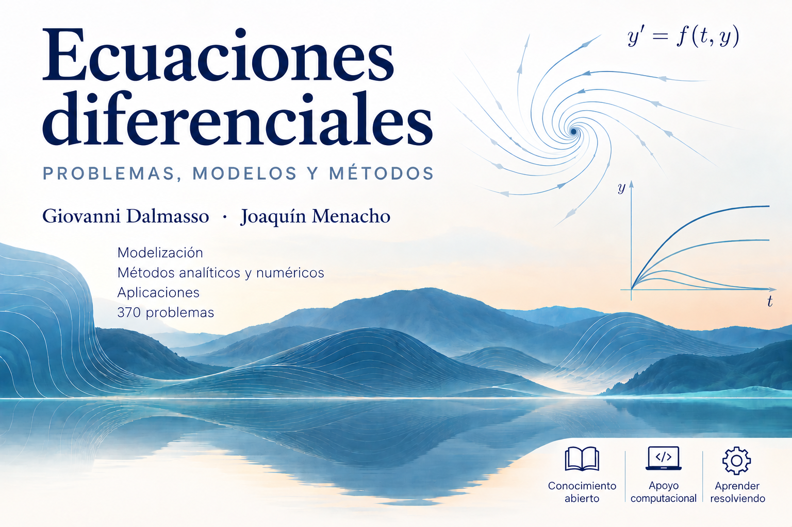

# Ecuaciones diferenciales: problemas, modelos y métodos

<p align="center">
  
</p>

<p align="center"><sub>Imagen generada con inteligencia artificial bajo dirección de los autores.</sub></p>

**Giovanni Dalmasso · Joaquín Menacho**

Edición del estudiante · v1.0.0.

Preparación provisional para Biblioteca IQS. El repositorio permanece privado mientras se completa el registro institucional DAU.

[Vista de la cubierta del libro](assets/cover-preview.png)

Libro de problemas para el aprendizaje y la práctica autónoma de las ecuaciones diferenciales, con aplicaciones en ciencias e ingeniería. La edición del estudiante reúne 370 ejercicios, respuestas de comprobación, 51 soluciones desarrolladas seleccionadas y nueve pistas.

**[Descargar la edición del estudiante](pdf/ecuaciones-diferenciales-v1.0.0.pdf)**

El recorrido comienza con los modelos de primer orden y continúa con ecuaciones lineales, oscilaciones, transformada de Laplace y sistemas. Incluye Fourier, Sturm–Liouville y una introducción a las ecuaciones del calor, de ondas y de Laplace. Los problemas piden formular hipótesis, elegir métodos, comprobar resultados e interpretar las soluciones.

La obra presupone cálculo de una variable. Los recordatorios teóricos son breves y las aproximaciones numéricas apoyan el razonamiento y la comparación con resultados analíticos.

## Ayuda numérica

[computation/mallas.py](computation/mallas.py) acompaña los dos ejercicios del libro que remiten a esa ayuda. Requiere Python 3 y utiliza únicamente su biblioteca estándar. Desde la raíz del repositorio:

```sh
python3 computation/mallas.py E0049
python3 computation/mallas.py E0068
```

La salida es una tabla CSV. Las hipótesis y la interpretación de los resultados forman parte del trabajo del estudiante. [Instrucciones de reproducción](REPRODUCIBILITY.md).

## Cita

Dalmasso, G. y Menacho, J. (2026). *Ecuaciones diferenciales: problemas, modelos y métodos*. Edición del estudiante, versión 1.0.0.

Los datos de cita también están disponibles en [CITATION.cff](CITATION.cff).

Registro institucional DAU: [HANDLE DAU PENDIENTE]. Biblioteca IQS asignará el identificador; los autores entregarán después el PDF definitivo para sustituir el provisional en el mismo registro.

Repositorio: [https://github.com/gioda/ecuaciones-diferenciales](https://github.com/gioda/ecuaciones-diferenciales).

## Licencias y créditos

El contenido educativo, las figuras originales y la documentación se distribuyen bajo [CC BY-SA 4.0](LICENSE); el archivo `computation/mallas.py`, bajo [MIT](LICENSE-CODE). Los retratos de los autores quedan excluidos de ambas licencias y no reciben una licencia general de reutilización. [Créditos y derechos de los activos](ASSET-RIGHTS.md).

Imagen de cubierta generada con inteligencia artificial bajo dirección de los autores; composición tipográfica realizada por separado. La concesión se limita a los derechos disponibles.

Giovanni Dalmasso pertenece al Departamento de Matemáticas y Analítica de Datos, y Joaquín Menacho al Departamento de Ingeniería Industrial de IQS, Universitat Ramon Llull. Las afiliaciones son informativas y no implican aval institucional.

## Erratas y versiones

Para comunicar una errata, indica la versión del PDF, el capítulo, el número visible del ejercicio, la página y una explicación del problema. Puede añadirse una comprobación breve. No adjuntes datos personales, evaluaciones privadas ni copias de material protegido de terceros.

Los cambios de cada versión se recogen en [CHANGELOG.md](CHANGELOG.md). Esta distribución contiene el PDF del estudiante, la vista de cubierta y la ayuda numérica.
